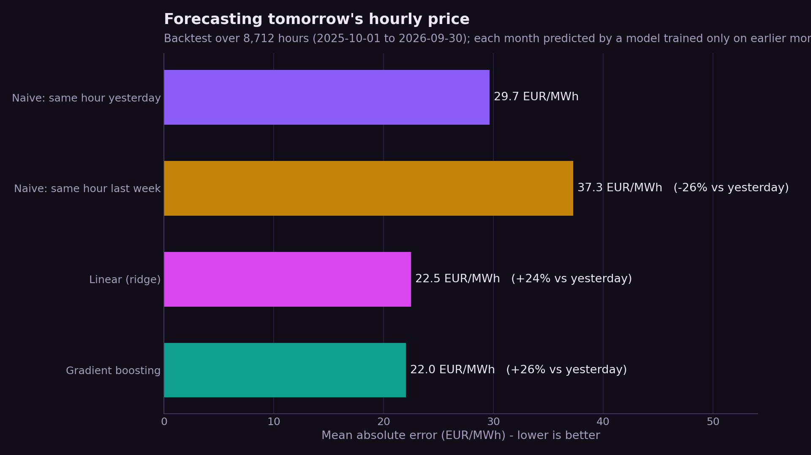
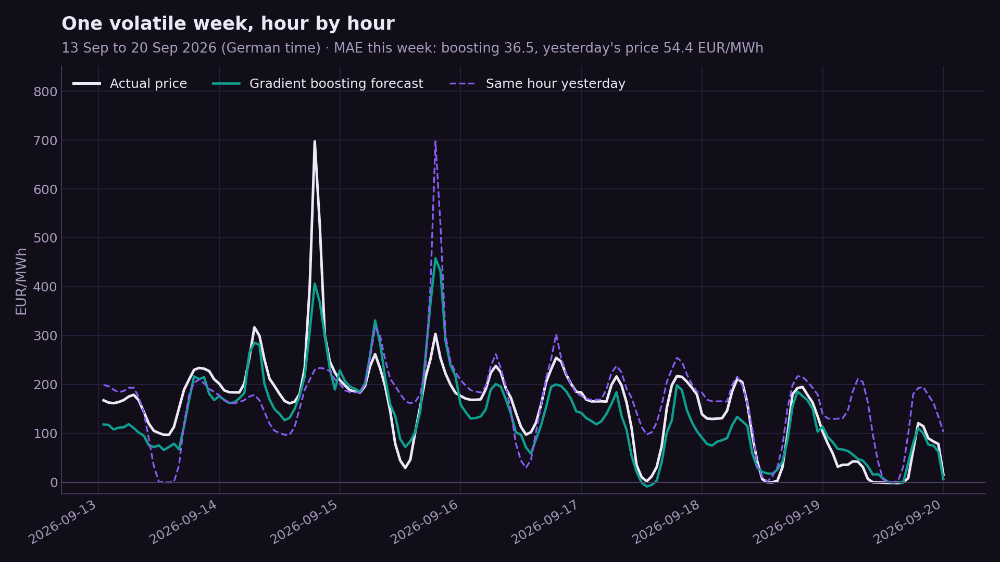
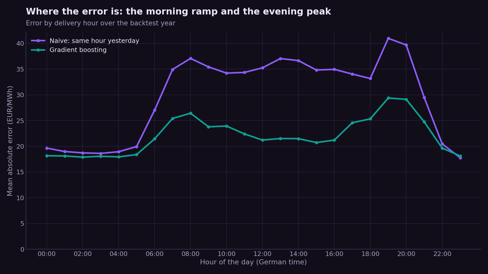
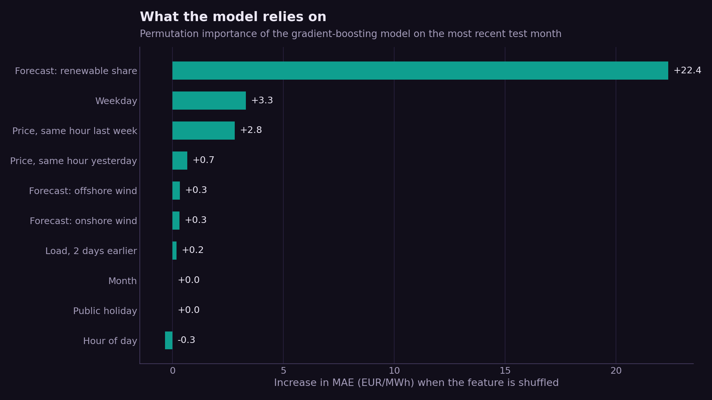

# German Day-Ahead Electricity Price Forecasting

Forecasting tomorrow's hourly wholesale electricity price for Germany/Luxembourg from public
data, and testing the forecast honestly: every month of the last year is predicted by a model
that has only seen earlier data, using only information available before the auction closes.

**Result:** gradient boosting cuts the error of the standard "same hour yesterday" forecast by
**26%** (mean absolute error 22.0 vs 29.7 EUR/MWh over 8,712 hours).



---

## The problem

Every day at 12:00, the EPEX SPOT day-ahead auction sets the electricity price for each hour of
the next day. Prices swing from below zero (sunny, windy middays) to several hundred EUR/MWh
(calm winter evenings). Battery operators, flexible industry and traders all need tomorrow's
prices before they are known.

## Data

All from [SMARD.de](https://www.smard.de), the electricity-market data platform of the German
Federal Network Agency (Bundesnetzagentur): free, no API key, licensed CC BY 4.0.

| Series | SMARD filter | Use |
|---|---|---|
| Day-ahead price, DE/LU (EUR/MWh) | 4169 | Target, and lagged as a feature |
| Actual grid load (MWh) | 410 | Lagged 2 and 7 days |
| Day-ahead forecasts: onshore wind, offshore wind, solar, total generation | 123, 3791, 125, 122 | Features for the target hour |

70,366 hourly prices from October 2018 (when the DE/LU price zone started) to October 2026.
`smard.py` downloads and caches everything; `data/smard_hourly.csv.gz` is the snapshot used here.

## Approach

**1. Exploration** (`notebooks/01_exploratory_analysis.ipynb`): twelve weeks of live prices,
the daily *duck curve*, weekday vs weekend, an hour × weekday heatmap and negative prices.
Cheapest hour on average was 13:00 (27.5 EUR/MWh, solar peak), priciest 20:00 (196.9); 8.4% of
hours were negative.

**2. Features that respect the auction timing.** For an hour of day D, the auction closes at
12:00 on D−1, so the model may only use:

| Feature | Available because |
|---|---|
| Price at the same hour 1 and 7 days earlier, and yesterday's average price | D−1's prices are published on D−2 |
| Actual load 2 and 7 days earlier | Actual load arrives with a delay |
| Forecast wind, solar and total generation for the hour, and the renewable share | The grid operators publish them before the auction |
| Hour, weekday, month, German public holiday | Known in advance |

`tests/test_features.py` enforces this: it changes one price or load value and checks that no
feature of an earlier day changes.

**3. Models.** Two naive baselines (same hour yesterday / last week), a ridge regression with
one-hot calendar features, and scikit-learn's histogram gradient boosting.

**4. Backtest.** Rolling origin over the last 12 complete months (October 2025 to September
2026): for each month, every model is retrained on all earlier data and predicts every hour of
that month.

## Results

| Model | MAE (EUR/MWh) | RMSE | vs. same hour yesterday |
|---|---|---|---|
| Same hour yesterday | 29.7 | 47.2 | — |
| Same hour last week | 37.3 | 57.3 | −26% |
| Ridge regression | 22.5 | 34.0 | +24% |
| **Gradient boosting** | **22.0** | **32.0** | **+26%** |



- **The renewable share is what matters.** Shuffling the forecast renewable share raises the
  error by 22 EUR/MWh, far more than any other feature: wind and solar set the price.
- **The linear model is almost as good.** Most of the gain comes from the right features, not
  from the model; gradient boosting adds a little, mostly on extreme hours.
- **Negative prices:** on the 508 negative-price hours, gradient boosting's error is 24.1
  EUR/MWh against 40.5 for yesterday's price.
- **Errors concentrate in the morning ramp and the evening peak**, where scarcity spikes are
  hardest to anticipate.





## Limitations

- **Errors grew in summer 2026.** Monthly MAE rose from 15–18 EUR/MWh (October to April) to
  30–39 EUR/MWh (July to September) as evening spikes reached 600–700 EUR/MWh. The features
  don't capture what drives those spikes (gas prices, plant outages, cross-border flows).
- **No load forecast.** SMARD doesn't publish a day-ahead load forecast, so load enters only as
  last week's actuals.
- **Point forecasts only.** Traders need ranges; quantile regression would be the next step.
- This project uses SMARD's hourly price series; since October 2025 the day-ahead auction
  itself also trades 15-minute products.

## Run it

```bash
pip install -r requirements.txt
python smard.py        # download / update the data (~6 min the first time, cached after)
python forecast.py     # backtest -> results/metrics.json, results/predictions.csv.gz, figures/
python -m pytest       # leakage tests
```

## Repository layout

```text
notebooks/01_exploratory_analysis.ipynb   live-data exploration (duck curve, negative prices, ...)
smard.py                                  SMARD downloader with a local cache
forecast.py                               features, models and the rolling-origin backtest
figures.py                                charts
tests/test_features.py                    checks that no feature uses future information
data/smard_hourly.csv.gz                  hourly snapshot (CC BY 4.0, Bundesnetzagentur | SMARD.de)
results/                                  metrics and every backtest prediction
```

---

*Chandana Gurusiddappa · M.Sc. Applied Data Science & AI, SRH University ·
[Portfolio](https://chandana18g.github.io) · [LinkedIn](https://www.linkedin.com/in/chandana-gurusiddappa-785563223/)*
